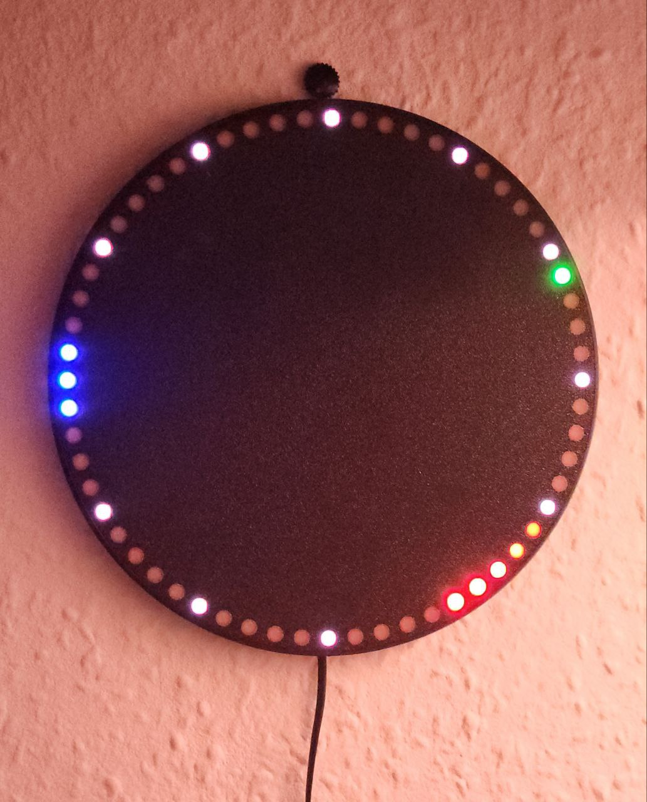

# ESPHome-Analog-Clock
ESPHome configuration to create an animated clock using a Neopixel 60 LED ring, that can also show **progress**, a
**countdown** and **alerts** on the ring.

[](https://www.youtube.com/watch?v=RIAHLAqe6oY)

# Features

* [x] "Loading" animation while initializing
* [x] Works with (almost) any LED strip length
* [x] Fading animations for all hands when switching
* [x] Slowly fading tail behind the second hand
* [x] Overlapping (additive) hand colors
* [x] Hand styles: Trail, Jump, Smooth, Comet
* [x] Settings
    * [x] Disable second hand
    * [x] Show hour indicators
    * [x] Wide hour hand
* [x] Views, shown instead of the plain clock face (see [docs/API.md](docs/API.md))
    * [x] Progress arc with any number of differently colored sections
    * [x] Countdown that drains back to 12 o'clock and blinks when the time is up
    * [x] Alert that breathes in a color
    * [x] Transitions between views: fade, wipe
    * [x] Animations when the progress changes: fade, fill, drop
    * [x] Follows the color and brightness of the light by default
* [x] Effects on top of any view: pulse, ripple, spin
* [x] Everything is also available as Home Assistant entities (view, transition, track, countdown, ...)

## How to use

The clock is an ESPHome [package](https://esphome.io/components/packages/): the light, its effects, all entities and the
API actions are in [analog_clock.yaml](./analog_clock.yaml), the animation code is in [clock.h](./components/analog_clock/clock.h).
See [examples/nodemcu.yaml](./examples/nodemcu.yaml) for a complete configuration of a NodeMCU.

* Create a new ESPHome configuration YAML file and customize the basic device configuration (Board, Wi-Fi, etc.),
  [examples/nodemcu.yaml](./examples/nodemcu.yaml) is a complete one for a NodeMCU
* Add the clock to it, straight from GitHub (use a release tag instead of `main` to avoid surprises):
  ```yaml
  external_components:
    - source: github://markusressel/ESPHome-Analog-Clock@main
      components: [analog_clock, virtual_addressable_light]

  packages:
    clock: github://markusressel/ESPHome-Analog-Clock/analog_clock.yaml@main

  time:
    - platform: sntp           # any time component, its id is `clock_time_id` below
      id: sntp_time
      timezone: Europe/Berlin
  ```
  Alternatively, clone this repository and use `type: local` / `!include` with its files, e.g. to change the code.
* Customize the clock with `substitutions:` (all of them are optional):

  | Substitution       | Default          | Meaning                                                                          |
  |--------------------|------------------|----------------------------------------------------------------------------------|
  | `num_leds`         | `60`             | Number of LEDs of the ring                                                       |
  | `clock_offset`     | `0`              | LED index at 12 o'clock                                                          |
  | `clock_pin`        | `RX`             | Data pin of the ring                                                             |
  | `clock_led_type`   | `GRB`            | Color order                                                                      |
  | `clock_led_variant`| `SK6812`         | LED chip (`WS2812X`, ...)                                                        |
  | `clock_led_method` | `ESP8266_DMA`    | [neopixelbus method](https://esphome.io/components/light/neopixelbus/), e.g. for ESP32 |
  | `clock_time_id`    | `sntp_time`      | Id of the time component                                                         |
  | `clock_max_output` | `14%`            | Current limit: the highest brightness the board can supply                       |
  | `clock_min_output` | `7`              | Smallest byte written for a lit pixel (`ceil(256 / (clock_max_output * 256))`)   |

* Add the contents of [examples/secrets.yaml](./examples/secrets.yaml) to your ESPHome secrets file, if you use the example
* Upload the configuration to your ESP device
  * Checkout the [ESPHome documentation](https://esphome.io/guides/getting_started_command_line.html) if you are new to ESPHome
  * Optional: Take a look at [esphome-deployment](https://github.com/markusressel/esphome-deployment) to automate ESHome device deployments without the need for Home Assistant Add-Ons or ESPHome Dashboard
* Create your watchface
  * Print a [paper watchface](#paper-print), or
  * [3D print](#3d-printed-case) a case
* Deploy and enjoy!

## Views and actions

The ring shows the clock by default. Other views are shown with the API actions `show_progress`, `show_countdown`,
`show_alert` and `show_clock`, or by choosing one in the "Clock View" select. All actions, entities and rules (e.g. views
are only visible while the light runs its "Clock" effect) are described in [docs/API.md](docs/API.md).

### Home Assistant

* From Home Assistant automations, call the actions as `esphome.<device>_show_progress` etc.

## Development

The animation logic is plain C++ that is tested on the host, without ESPHome:

```shell
make test      # unit tests of clock.h with coverage
make compile   # compile the example with the files of this checkout instead of GitHub
```

`components/virtual_addressable_light` is shared with the author's other LED devices. If you change it here, copy the change back
(`make sync-component` copies the other way, see the Makefile).

## Watchface

### Paper Print

The provided [Watchface.svg](Watchface.svg) perfectly fits on the 60 LED NeoPixel ring.
You can print this, cut it out and simply glue/tape it to the ring to create the look visible in the video above. 

### 3D Printed Case

A simple 3D printed case can be found here:
https://cad.onshape.com/documents/0e006a8827f608cb658e942e/w/b4c3cdc5ddb2e7bb623cce6a/e/1f500e2bfa3036f79058a29e?renderMode=0&uiState=697d0fb9b6af62c58ba61274



# Contributing

GitHub is for social coding: if you want to write code, I encourage contributions through pull requests from forks
of this repository. Create GitHub tickets for bugs and new features and comment on the ones that you are interested in.

# License

CC0 see [LICENSE](./LICENSE)
